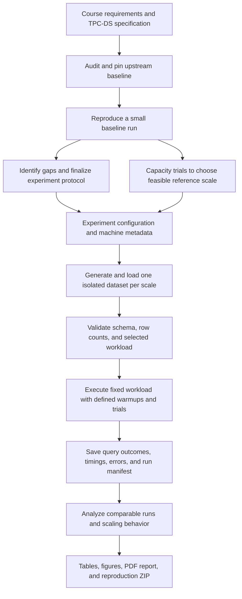

# Architecture and execution flow

Status: proposed design. Only the environment check is implemented so far.

## Boundaries

- **Engine:** DuckDB and its official TPC-DS extension provide database execution
  and generation/query capabilities where appropriate for the baseline.
- **Upstream baseline:** a separate public implementation, pinned to a commit,
  provides the starting workflow. Its original behavior must be reproduced first.
- **Project additions:** local orchestration, validation, or analysis address only
  gaps demonstrated by the baseline audit. They are identified separately in the report.

This is a local batch workflow using persistent DuckDB files. Python can handle
configuration, execution, and analysis. The baseline may supply shell scripts or
other tooling; reuse those where practical.

## Main flow



## Modules and ownership

| Location | Responsibility | Main output |
| --- | --- | --- |
| `docs/` | Requirements, baseline audit, decisions, protocol | Reviewable research and methodology |
| `baseline/` | Upstream URL, exact commit, license, setup evidence | Traceable starting implementation |
| `experiments/` | Describe scale, workload, seed, trials, and settings | Versioned configuration |
| `scripts/` | Invoke baseline and implement proven missing capabilities | Reproducible commands |
| `data/` | Hold isolated databases and generation scratch space | Local datasets |
| `results/raw/` | Preserve detailed measurements and manifests | Local CSV/JSON evidence |
| `results/summaries/` | Aggregate results from raw evidence | Small tables and analysis outputs |
| `report/` | Explain methods, findings, limitations, and attribution | Report sources and figures |

## Experiment lifecycle

1. Resolve the pinned software versions and configuration; assign a unique run ID.
2. Record CPU, RAM, OS, available storage, source commit, upstream commit, and engine settings.
3. Generate/load a dataset into its own database. Log generation/loading duration,
   actual row counts, requested scale, and file size separately from query timing.
4. Validate the dataset and workload before starting measurements. Record validation
   failures and do not treat an invalid dataset as a successful experiment.
5. Apply the protocol's warmup, cache, query-order, timeout, and concurrency rules.
   Fetch query results to completion before stopping the query timer.
6. Persist each query's ID, trial, elapsed time, outcome, and error/timeout reason.
   Preserve failures rather than dropping them from aggregates.
7. Derive summaries from saved records and link figures to their inputs and run IDs.

Use the same workload and settings across scales. A benchmark run must record any
deviation. Reusing cached data requires validation; reruns must not overwrite prior
evidence. Timeout enforcement and recovery are implementation decisions still to
be resolved after the baseline audit.

## Data and version control

Version source, dependency pins, configurations, provenance, documentation, and
small selected summaries/figures. Keep environments, generated datasets, temporary
files, and detailed raw runs local using `.gitignore`. Retain raw evidence locally;
document its run IDs and archive location when producing the report.

Suggested future local paths (not implemented commands):

```text
data/sf1/warehouse.duckdb
data/sf1/tmp/
results/raw/<run-id>/manifest.json
results/raw/<run-id>/queries.csv
results/summaries/<experiment-id>.csv
```

The final four scale values, settings, configuration schema, scripts, and query
coverage remain pending. Do not interpret this design as evidence of completed runs.
